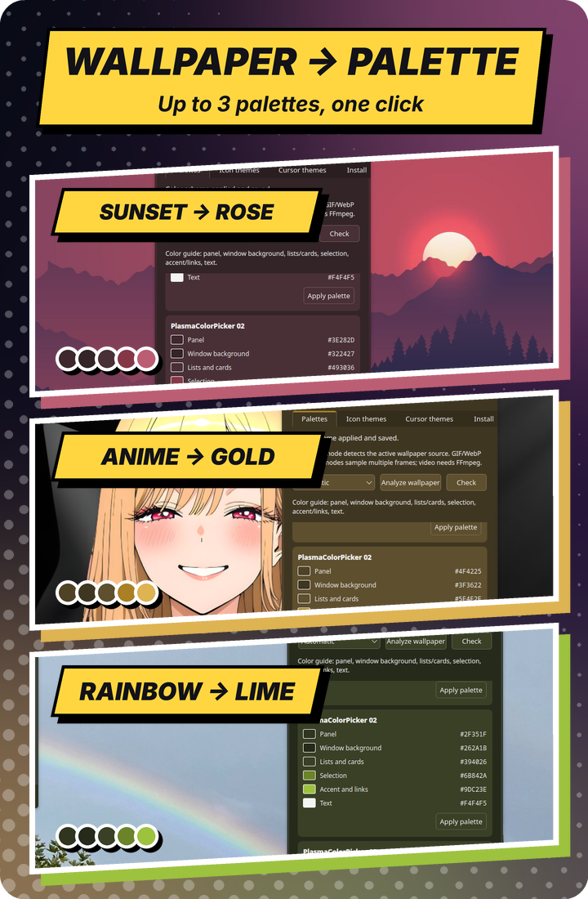
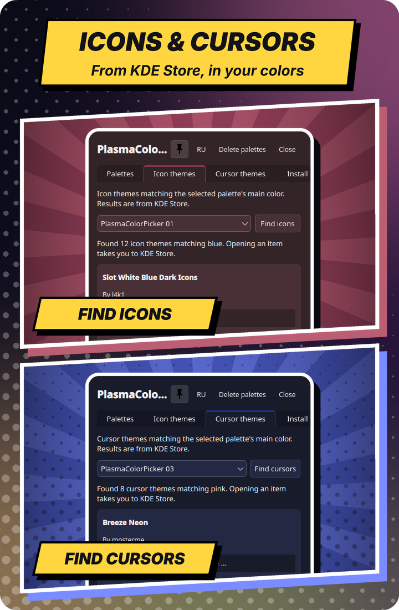
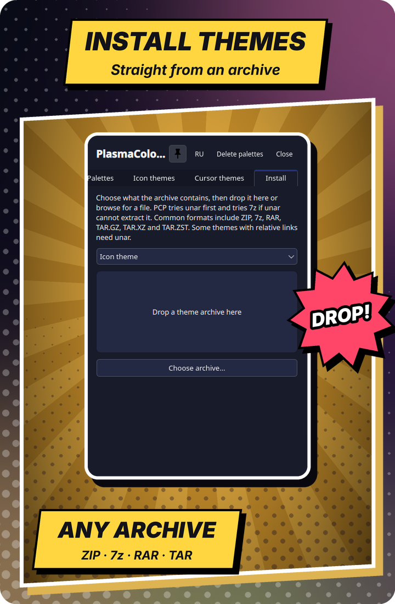

<h1 align="center">PlasmaColorPicker (PCP) — Early Access</h1>

<p align="center"></p>

[Русский](README.ru.md) | **English**

PlasmaColorPicker is a widget for KDE Plasma 6. It can:

- look at your current wallpaper and suggest up to three matching color palettes;
- apply a palette to Plasma;
- find matching icon and cursor themes in KDE Store;
- install an icon or cursor theme from an archive.

The widget acts only when you press a button. It does not watch your wallpaper
or send it anywhere. Internet access is used to search KDE Store and, once when
you first open PCP in a session, to check GitHub for code updates. The update
check excludes README files and only reports differences; it never downloads or
installs updates.

## Install

Open a terminal and run these commands one at a time:

```sh
git clone https://github.com/neverloseagain1/PlasmaColorPicker
cd PlasmaColorPicker
./install.sh
```

The installer asks which language to use, checks the programs it needs, builds
the widget, and installs it for your account. If something is missing, it shows
the packages it needs and asks before installing them through your Linux
system's official package manager. You may be asked for your password by
`sudo`. The installer does not install anything if you say no.

Automatic dependency installation is prepared for Fedora, Debian and Ubuntu,
Arch Linux, and openSUSE. On other distributions, install the missing programs
from their official repositories and run the installer again. The required
programs are Rust/Cargo, a C compiler, KDE Plasma 6 command-line tools, a KDE
settings tool, and `unar` or `7z` for theme archives.

After installation, right-click your desktop or panel, choose **Add Widgets**,
find **PlasmaColorPicker (PCP)**, and add it.

If the `git` command is not found, install Git from your distribution's official
repositories and then run the commands above.

## Use

Click the PCP icon to open the widget. Use **EN/RU** at the top to change the
widget language. The installer's language choice affects only installer
messages.

### Palettes

<table>
<tr>
<td width="55%" valign="top">
<p>
On <strong>Palettes</strong>, choose a source type or leave <strong>Automatic</strong>, then select
<strong>Analyze wallpaper</strong>. Automatic mode reads the active Plasma wallpaper
plugin's settings and handles still images, GIF/WebP animations, and video
accordingly. GIF and animated WebP analysis samples multiple frames; video
analysis samples frames across the clip. Video analysis requires <code>ffmpeg</code> and
<code>ffprobe</code> from FFmpeg. PCP also reads enabled video entries from Smart Video
Wallpaper Reborn's playlist. <strong>Slideshow</strong> samples up to eight images from its
configured folders.
</p>

<p>
PCP shows color suggestions and what each color is for. Select <strong>Apply palette</strong>
to save and use one. PCP keeps the original Plasma theme unchanged and makes
its own copy for the new colors.

<strong>Delete palettes</strong> removes palettes made by PCP and restores the previous
appearance, including any accent and inactive-header colors PCP temporarily
overrode.
</p>
</td>
<td width="45%" valign="top"></td>
</tr>
</table>

### Find and install themes

<table>
<tr>
<td width="45%" valign="top"></td>
<td width="55%" valign="top">
<p>
On <strong>Icon themes</strong> or <strong>Cursor themes</strong>, choose a palette and select <strong>Find
icons</strong> or <strong>Find cursors</strong>. Choose a result to open it in KDE Store.
If KDE Store's catalog API is unavailable, PCP shows the API error and offers a
direct search on the store website.
</p>
</td>
</tr>
</table>

<table>
<tr>
<td width="55%" valign="top">
<p>
On <strong>Install</strong>, choose whether the archive contains icons or cursors. Drop the
archive into the box or choose a file. PCP checks folders inside the archive,
including archives wrapped inside other archives, and installs every matching
theme it finds. It supports high-resolution icon themes and does not replace an
existing theme. PCP tries <code>unar</code> first and tries <code>7z</code> if <code>unar</code> cannot unpack
the file. Absolute links to files or folders in installed icon and cursor
themes are safely copied into the installed theme; links outside theme
directories are rejected. Some themes with internal links require <code>unar</code>. If
PCP cannot install an archive, it explains what to do next. Supported formats
depend on the installed extractor and include ZIP/ZIPX, 7z, RAR, TAR and
compressed TAR, CAB, ISO, LZH, RPM, and other formats recognized by <code>unar</code> or
<code>7z</code>. PCP detects common archive signatures as well as file extensions,
including for nested archives.
</p>

<p>
To use an installed theme, open <strong>System Settings → Colors &amp; Themes → Icons</strong>
or <strong>Cursors</strong> and select it. If that page was already open, close and reopen
it.
</p>
</td>
<td width="45%" valign="top"></td>
</tr>
</table>

### Updates

The **Update** tab checks the GitHub repository once when you first open PCP
during a session. It compares file contents with the installed version, ignores
README files, and reports whether a newer version is available. The check is
informational only: PCP does not download or install updates automatically.
Select **Check for updates** to check again at any time. If an update is found,
**Update widget** opens the project page on GitHub, where you can download and
install it yourself.

### Install a theme manually

If PCP cannot install an archive, extract it with your archive manager and find
the theme folder containing `index.theme`. Replace `/path/to/ThemeFolder` in
the appropriate command with that folder's path, then run the command as your
regular user (no `sudo`):

```sh
# Icon theme
mkdir -p "$HOME/.local/share/icons"
cp -a "/path/to/ThemeFolder" "$HOME/.local/share/icons/"

# Cursor theme
mkdir -p "$HOME/.icons"
cp -a "/path/to/ThemeFolder" "$HOME/.icons/"
```

These shell commands work on Fedora, Arch Linux, Debian, Ubuntu, openSUSE, and
other common Linux distributions. Both icon and cursor themes are selected in
**System Settings → Colors & Themes**. Do not copy over an existing theme with
the same folder name; back it up or choose a different theme first.

## Remove

To remove the widget and its icon from your account, run:

```sh
./uninstall.sh
```

This leaves palettes you previously applied and themes you installed unchanged.

## Notes

Some third-party wallpaper plugins keep their media source in plugin-specific
settings that PCP cannot recognize. Theme descriptions shown in search results
come from KDE Store and may be written in another language.
