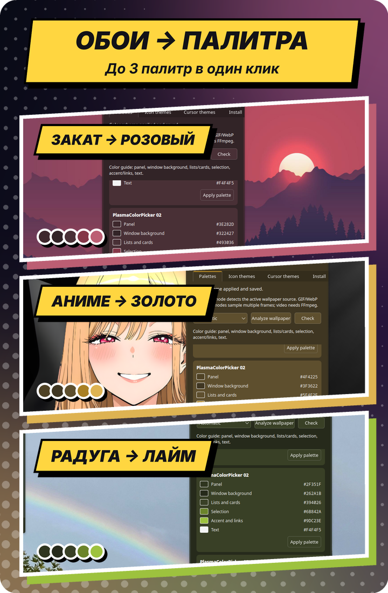
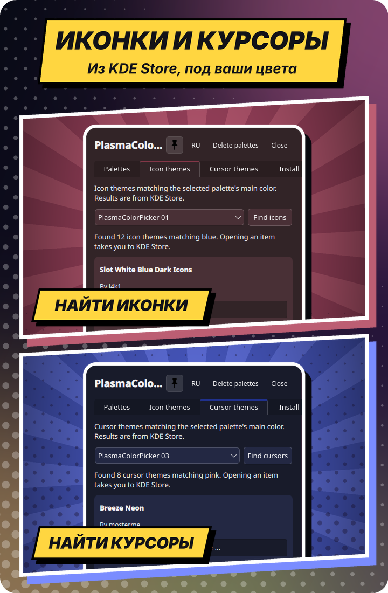
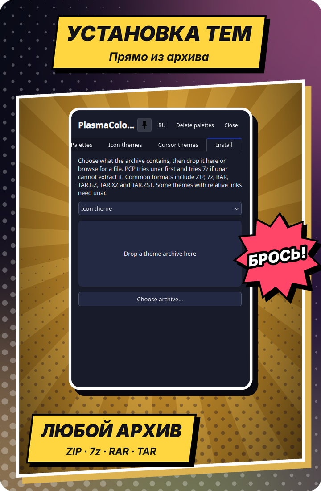

# PlasmaColorPicker (PCP) — ранний доступ

<p align="center"></p>

**Русский** | [English](README.md)

PlasmaColorPicker — виджет для KDE Plasma 6. Он умеет:

- смотреть на текущие обои и предлагать до трёх подходящих цветовых схем;
- применять выбранные цвета в Plasma;
- искать подходящие темы значков и курсоров в KDE Store;
- устанавливать тему значков или курсоров из архива.

Виджет работает только после нажатия кнопки. Он не следит за обоями в фоне и
никуда их не отправляет. Интернет нужен только для поиска в KDE Store.

## Установка

Запустите:

   ```sh
   git clone https://github.com/neverloseagain1/PlasmaColorPicker
   cd PlasmaColorPicker
   ./install.sh
   ```

Установщик предложит выбрать язык, проверит необходимые программы, соберёт и
установит виджет для вашей учётной записи. Если чего-то не хватает, он покажет
список пакетов и спросит разрешение на их установку через официальный менеджер
пакетов вашего Linux. При установке система может запросить пароль через
`sudo`. Если отказаться, ничего устанавливаться не будет.

Автоматическая проверка и установка подготовлена для Fedora, Debian и Ubuntu,
Arch Linux и openSUSE. В других системах установите недостающие программы из
официальных репозиториев и запустите скрипт ещё раз. Нужны Rust/Cargo,
компилятор C, команды KDE Plasma 6, утилита настроек KDE и `unar` или `7z` для
архивов тем.

После установки щёлкните правой кнопкой мыши по рабочему столу или панели,
выберите **Добавить виджеты**, найдите **PlasmaColorPicker (PCP)** и добавьте
его.

## Как пользоваться

Нажмите на значок PCP, чтобы открыть виджет. Кнопка **EN/RU** вверху меняет язык
виджета. Выбор языка в установщике влияет только на его сообщения.

### Цветовые схемы

<table>
<tr>
<td width="55%" valign="top">
<p>На вкладке <strong>Палитры</strong> нажмите <strong>Анализировать обои</strong>. PCP покажет варианты и подпишет, для чего нужен каждый цвет. Нажмите <strong>Применить палитру</strong>, чтобы сохранить и использовать выбранный вариант. Исходная тема Plasma не меняется: PCP создаёт её отдельную копию для новых цветов.</p>
<p>Кнопка <strong>Удалить палитры</strong> удаляет созданные PCP палитры и возвращает прежний вид.</p>
</td>
<td width="45%" valign="top"></td>
</tr>
</table>

### Поиск и установка тем

<table>
<tr>
<td width="45%" valign="top"></td>
<td width="55%" valign="top">
<p>На вкладке <strong>Темы значков</strong> или <strong>Темы курсоров</strong> выберите палитру и нажмите <strong>Найти значки</strong> или <strong>Найти курсоры</strong>. Выберите результат, чтобы открыть его в KDE Store.</p>
</td>
</tr>
</table>

<table>
<tr>
<td width="55%" valign="top">
<p>На вкладке <strong>Установить</strong> укажите, что находится в архиве: значки или курсоры. Перетащите архив в область или выберите файл. PCP проверит его и установит подходящие темы для вашей учётной записи. Уже установленная тема не заменяется. Если архив не получится установить, виджет объяснит, что делать дальше.</p>
<p>Чтобы включить установленную тему, откройте <strong>Параметры системы → Цвета и темы → Значки</strong> или <strong>Курсоры</strong> и выберите её. Если эта страница уже была открыта, закройте её и откройте снова.</p>
</td>
<td width="45%" valign="top"></td>
</tr>
</table>

## Удаление

Чтобы удалить виджет и его значок из своей учётной записи, выполните в папке проекта:

```sh
./uninstall.sh
```

Применённые палитры и установленные темы останутся на месте.

## Важно

Некоторые виды обоев, например слайд-шоу, видео обои и т.д не предоставляют PCP изображение для
анализа. Описания тем в результатах поиска приходят из KDE Store и могут быть
написаны на другом языке.
